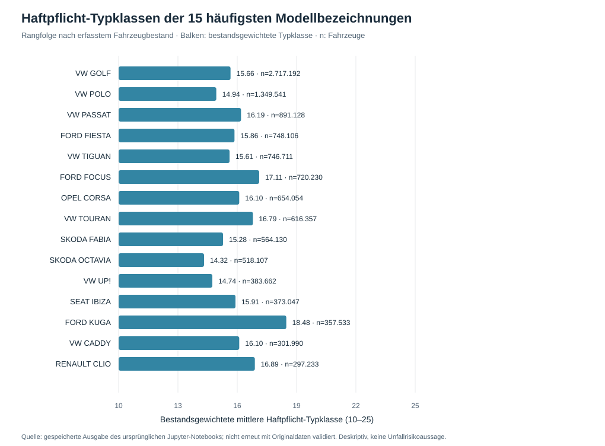

# Kfz-Haftpflicht-Typklassen und Fahrzeugbestände

**Eigenständiges Python-Datenanalyseprojekt** zur Verknüpfung von Fahrzeugbestandsdaten mit Versicherungstypklassen über **Herstellerschlüsselnummer (HSN)** und **Typschlüsselnummer (TSN)**. Ziel ist die nachvollziehbare Aufbereitung, deskriptive Analyse und Visualisierung von Bestands- und Typklassendaten.

## Beispiel aus der bisherigen Analyse



Die Abbildung ist aus **zwischengespeicherten Ergebnissen des ursprünglichen Jupyter-Notebooks** erstellt. Die Werte sind **nicht erneut mit den Originaldateien validiert**. Es handelt sich um aggregierte Modellbezeichnungen, nicht um kontrollierte Vergleiche einzelner Fahrzeugmodelle oder Fahrergruppen. Der ursprüngliche Notebook-Lauf meldete für die verknüpften Datensätze 47.446.751 Fahrzeuge; das ist nicht mit dem gesamten deutschen Pkw-Bestand gleichzusetzen.

## Vorgehen

1. Zwei Datensätze mit HSN und TSN als Zeichenketten einlesen und die Schlüssel vereinheitlichen.
2. Prüfen, ob HSN/TSN-Kombinationen in den Eingangstabellen eindeutig sind.
3. Daten über HSN/TSN verknüpfen, nicht zuordenbare Einträge sichtbar machen und die Abdeckung nach Fahrzeugbestand ausgeben.
4. Für die Haftpflicht-Auswertungen nur positive Bestände mit gültiger Haftpflicht-Typklasse 10–25 verwenden.
5. Kennzahlen bestandsgewichtet berechnen, zum Beispiel

   `gewichteter Mittelwert = Summe(Typklasse_i × Fahrzeugbestand_i) / Summe(Fahrzeugbestand_i)`

6. Auswertungen als CSV und Diagramme exportieren; HSN-Vergleiche auf ausreichend große Bestände einschränken.

## Installation und Ausführung

Voraussetzung: Python 3.10+ und die beiden **selbst bereitgestellten** Eingabedateien. Es werden absichtlich keine ungeprüft weiterverteilten Originaldaten mitgeliefert. Die Dateiformate stehen in [data/README.md](data/README.md).

```bash
python -m pip install -r requirements.txt
python src/analyse_kfz.py --kba data/typen.csv --ams data/kfzTypen.ams
```

Bei einem erfolgreichen Lauf werden unter `results/` die erfasste Datenabdeckung, CSV-Statistiken und Diagramme erzeugt. Mit `--minimum-stock 100000` lässt sich der Mindestbestand für HSN-Vergleiche einstellen.

**Ohne die Originaleingabedateien ist eine vollständige Reproduktion der realen Ergebnisse nicht möglich.** Für einen synthetischen Funktionstest ohne Originaldaten:

```bash
python -m unittest discover -s tests -v
```

## Projektstruktur

- [src/analyse_kfz.py](src/analyse_kfz.py) – Datenimport, HSN-/TSN-Abgleich, gewichtete Kennzahlen und Visualisierung
- [tests/](tests/) – kleiner Funktionstest mit ausdrücklich fiktiven Daten
- [data/README.md](data/README.md) – erwartete Eingangsdaten und Hinweise zu Nutzungsrechten
- [results/](results/) – gespeicherter Notebook-Auszug und Ausgabeordner für neue Berechnungen
- [requirements.txt](requirements.txt) – Python-Abhängigkeiten

## Datenstand und Quellen

Das ursprüngliche Notebook bezieht sich auf eine KBA-Fahrzeugbestandsdatei (`typen.csv`) und eine gesonderte Typklassendatei (`kfzTypen.ams`). Im Material befand sich außerdem eine Datei mit dem Namen `fz6_2024.xlsx`. **Ob die verwendete CSV exakt diesem Tabellenstand entspricht und welcher Stand der Typklassendatei zugrunde liegt, muss anhand der Quelldateien abschließend überprüft werden.** Die Datenjahre werden daher bewusst nicht als gesichert ausgegeben.

Die Quelldateien sind im öffentlichen Repository nicht enthalten. Herkunft, Stand und mögliche Lizenz-/Weitergabebedingungen sind vor einer erneuten Veröffentlichung der Rohdaten zu prüfen.

## Statistische Grenzen

- Eine Typklasse ist eine **versicherungstarifliche Einstufung**, keine individuelle Unfallwahrscheinlichkeit, gemessene Schadenhäufigkeit oder eindeutige Aussage über Fahrverhalten.
- HSN-Kennzahlen sind nicht automatisch mit Herstellermarken gleichzusetzen. Modellmix und Zuordnungsabdeckung beeinflussen die Ergebnisse.
- Fehlende HSN-/TSN-Zuordnungen können zu einer selektiven Stichprobe führen; deshalb gibt das Skript Abdeckungsquoten aus.
- Die Analyse ist **deskriptiv**, kein Kausalnachweis, kein Tarifmodell und keine aktuarielle Schadenreservierung.
- Das Skript wurde zuvor mit künstlichen Testdaten auf grundlegende Ausführbarkeit geprüft; ein vollständiger Real-Daten-Abgleich steht noch aus.
