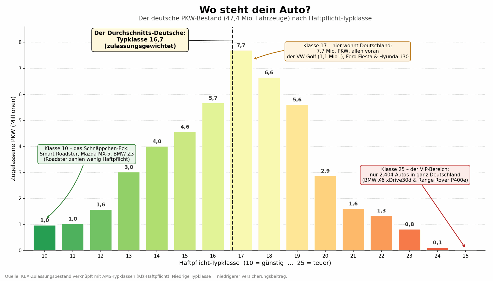
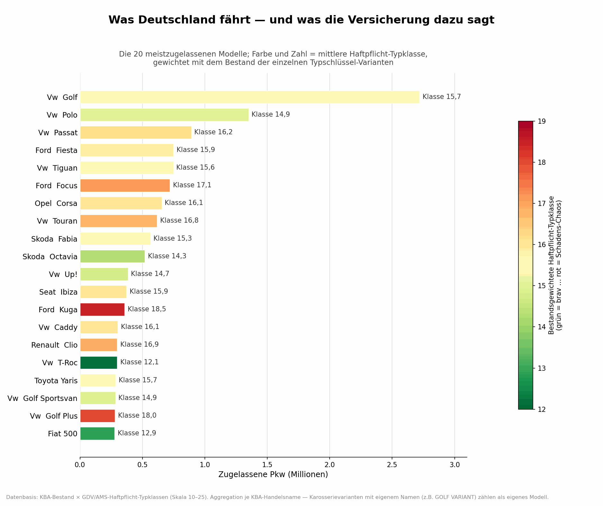
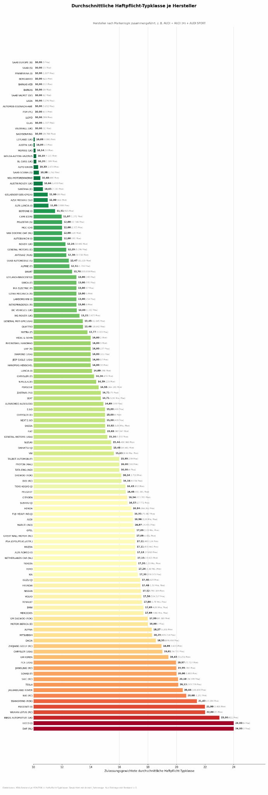
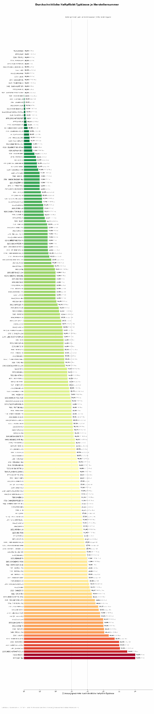
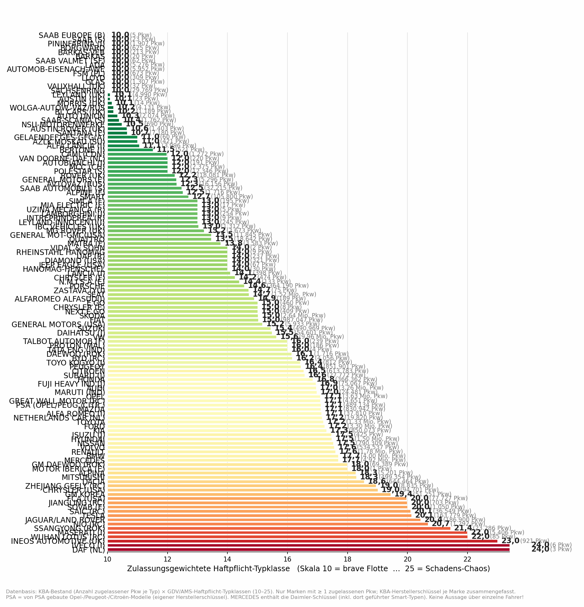
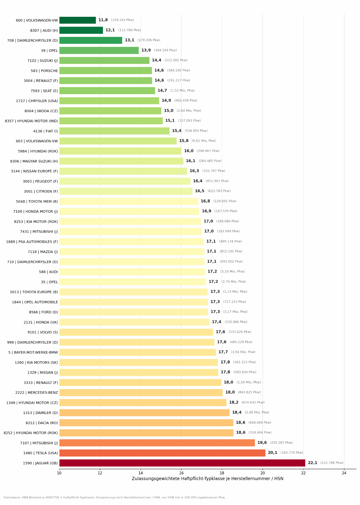
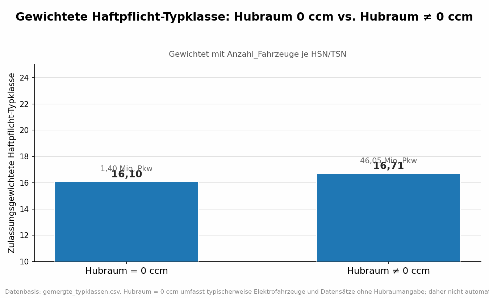
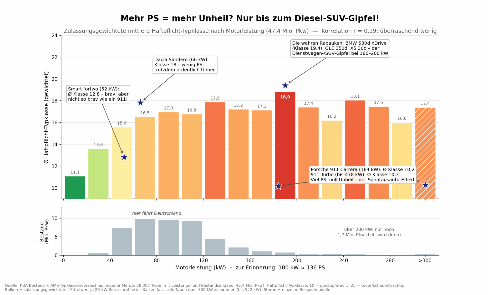
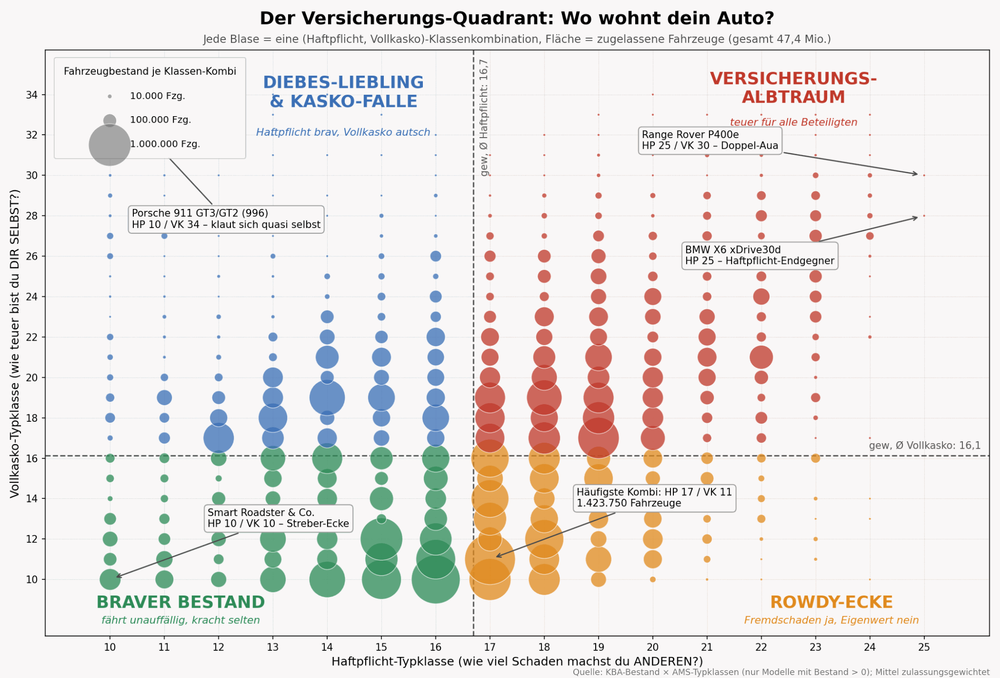
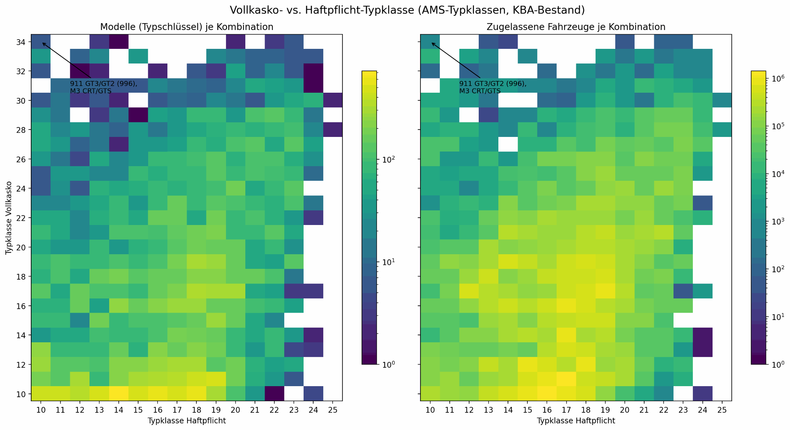

# Ergebnisgalerie – Kfz-Haftpflicht-Typklassen und Fahrzeugbestand

Die folgenden **zehn Diagramme** stammen aus der ursprünglichen explorativen Datenanalyse und wurden vom Projekturheber als Grafiken bereitgestellt. Die PNG-Dateien wurden lediglich **für GitHub komprimiert**, nicht fachlich neu berechnet.

**Wichtiger Hinweis:** Die veröffentlichten Grafiken wurden noch **nicht unabhängig anhand der ursprünglichen Rohdatensätze reproduziert oder fachlich validiert**. Der in mehreren Abbildungen genannte Bestand von rund 47,4 Mio. Fahrzeugen bezieht sich auf die verknüpften bzw. in der Analyse betrachteten Daten, **nicht automatisch auf den vollständigen deutschen Pkw-Bestand**. Der Stand der verwendeten Typklassendaten muss noch geprüft werden.

Haftpflicht- und Vollkasko-Typklassen sind **tarifliche Einstufungen**. Sie sind weder direkte Unfallwahrscheinlichkeiten noch isolierte Preise; tatsächliche Beiträge hängen von weiteren Faktoren ab. Sprachliche Zuspitzungen in den Originalgrafiken (z. B. „Unheil“, „Schnäppchen“, „VIP“, „Versicherungs-Albtraum“) sind **illustrativ, nicht als statistische Risikobehauptung zu verstehen**.

## A. Verteilung und häufige Modelle

**1. Fahrzeugbestand nach Haftpflicht-Typklasse.** Einordnung der in der Analyse verknüpften Bestände, einschließlich der dargestellten gewichteten Durchschnittsklasse.

**2. Häufige Modellbezeichnungen.** Balken zeigen den erfassten Fahrzeugbestand; Farbe/Annotation die jeweilige bestandsgewichtete Haftpflicht-Typklasse. Modellbezeichnungen sind nicht zwangsläufig homogene technische Varianten.

## B. Hersteller und Herstellerschlüssel

**3. Aggregation nach zusammengeführten Herstellerbezeichnungen.** Die Herstellerzuordnung ist nicht notwendigerweise mit einem einheitlichen Risiko vergleichbar; bei sehr kleinen Fallzahlen sind extreme Werte besonders instabil.

**4. Aggregation nach Herstellerschlüssel (lange Vollübersicht).** Eine HSN ist nicht automatisch identisch mit einer Marke. Für seriöse Vergleiche sollten kleine Bestände ausgeschlossen werden.

**5. Experimentelles Markenranking.** Auch Kategorien mit winzigen Beständen können vorkommen; nicht als belastbares Markenranking lesen.

**6. HSN-Ranking mit Mindestbestand.** Für eine belastbare Interpretation sind dennoch die verwendeten Zuordnungen, Bestandsgrößen und Datenstände zu prüfen.

## C. Fahrzeugmerkmale

**7. Hubraum gleich null versus ungleich null.** Hubraum = 0 ist kein sicherer Nachweis für einen Elektroantrieb; fehlende Angaben können denselben Wert haben.

**8. Motorleistung und Haftpflicht-Typklasse.** Deskriptiver Vergleich mit zusätzlichen einzelnen Fahrzeugbeispielen. Die im Originaldiagramm dargestellte Korrelation ist keine kausale Aussage.

## D. Haftpflicht und Vollkasko gemeinsam

**9. Kombinationen als Blasendiagramm.** Blasengrößen zeigen den Bestand je Klassenkombination. Quadrantenbezeichnungen sind pointierte Bildsprache, keine versicherungsmathematische Bewertung.

**10. Zwei Heatmaps.** Links die Anzahl von Typenschlüssel-Varianten und rechts die jeweilige Anzahl zugelassener Fahrzeuge nach Haftpflicht- und Vollkaskoklasse; die Legenden sind logarithmisch skaliert.

---

**Methodik und Code:** zurück zur [Projekt-README](../README.md). Die grafischen Ergebnisse entstammen der ursprünglichen Notebook-Analyse; das aufgeräumte Skript unter `src/` bildet einen dokumentierten Kernablauf ab, nicht zwingend alle hier gezeigten Spezialauswertungen.
